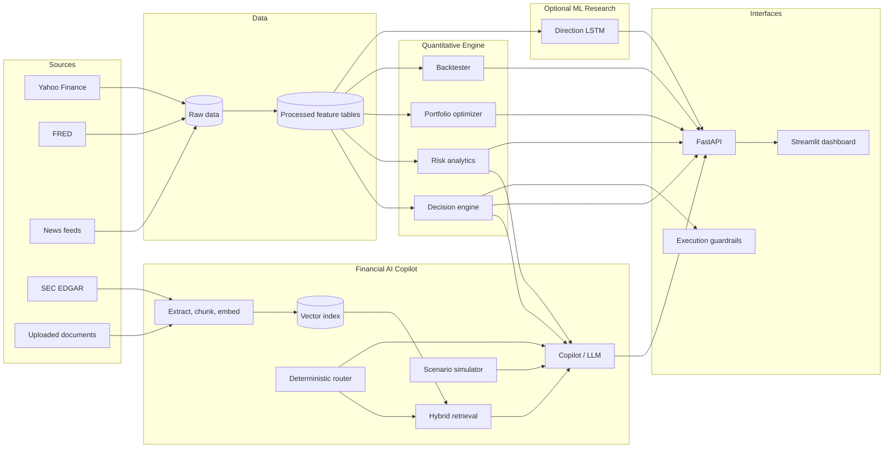

# AlphaForge AI

**Multi-asset market intelligence and investment decision-support platform with an evidence-grounded financial AI copilot.**


AlphaForge AI combines a deterministic quantitative engine with a retrieval-augmented
generation (RAG) copilot. The engine collects and processes market data, engineers
features, produces BUY/HOLD/SELL decisions with explanations, measures risk,
constructs portfolios and backtests strategies. The copilot retrieves evidence from
financial filings and answers questions in natural language — but every number it
reports comes from the quantitative engine, never from the language model.

An optional, separately evaluated LSTM layer can estimate next-session direction.
It is research-only: its probability is not blended into the decision engine, and
its published metrics are close to a majority-class baseline.

> Decision-support software only. This is not investment advice, and it does not
> predict markets. See [Disclaimer](#disclaimer).

---

## Table of Contents

- [Overview](#overview)
- [Architecture](#architecture)
- [Core Capabilities](#core-capabilities)
- [Direction Models (Optional)](#direction-models-optional)
- [Financial AI Copilot](#financial-ai-copilot)
- [Trading Execution (Opt-In)](#trading-execution-opt-in)
- [Tech Stack](#tech-stack)
- [Getting Started](#getting-started)
- [Usage](#usage)
- [API Reference](#api-reference)
- [Project Structure](#project-structure)
- [Testing, Evaluation and Quality](#testing-evaluation-and-quality)
- [Security and Safety](#security-and-safety)
- [Operational Notes](#operational-notes)
- [Limitations and Roadmap](#limitations-and-roadmap)
- [Contributing](#contributing)
- [License](#license)
- [Disclaimer](#disclaimer)

## Overview

The platform is designed around a simple separation of concerns:

- **The quantitative engine owns every number.** Prices, risk scores, portfolio
  statistics, backtest results and scenario math are computed by deterministic
  Python code in `src/engine/`, `src/portfolio/` and `src/ai/metrics.py`.
- **The LLM explains, never calculates.** Retrieved documents provide qualitative
  evidence (filings, disclosures, news); the engine provides verified metrics. The
  generated answer must cite retrieved sources, and fabricated metrics are rejected
  by construction.
- **Graceful degradation is a feature.** With no API keys, no vector database and no
  LLM server, the platform still runs end-to-end using cached data, lexical
  embeddings and deterministic retrieval-only answers.
- **The core platform has no heavy dependencies.** The AI copilot and trading
  execution are optional layers; `/api/v1` works with the base install alone.

### Asset Coverage

| Asset class | Instruments |
|---|---|
| Equities | AAPL, MSFT, NVDA, GOOGL, AMZN, META, TSLA, AMD |
| Indices | S&P 500, Nasdaq Composite, Dow Jones, Russell 2000, VIX |
| ETFs | SPY, QQQ, XLK, SOXX, VGT |
| Commodities | Gold, Silver, Crude Oil, Natural Gas |
| FX | EUR/USD, GBP/USD, USD/JPY, USD/CNY |
| Macro (FRED) | Fed funds rate, CPI, GDP, unemployment, PPI, dollar index |
| News | Yahoo Finance feed and NewsAPI (optional) |
| Filings | SEC EDGAR 10-K, 10-Q, 8-K (optional, public endpoints) |

The universe is centralised in `src/utils/config.py`; changing it does not require
touching pipeline code.

## Architecture



## Core Capabilities

### Data Collection and Preprocessing

- Daily OHLCV from Yahoo Finance for equities, indices, ETFs, commodities and FX.
- Macroeconomic series from FRED, including Fed funds, CPI, GDP, unemployment, PPI
  and the dollar index.
- Headlines from Yahoo Finance plus optional NewsAPI.
- Business-day alignment, missing-value handling, outlier clipping and daily macro
  alignment.
- Raw data is cached locally; processed artifacts are stored as Parquet for fast,
  reproducible reloads.
- Offline mode: the pipeline runs entirely from cached data with `--skip-collect`.

### Feature Engineering

- Technical indicators: RSI-14, MACD line/signal/histogram, Bollinger Bands
  (upper/middle/lower, width, %B), ATR-14.
- Trend features: SMA-10/20/50/200 and price-to-SMA distances.
- Volume features: 20-day volume z-score and volume change.
- Return lags at 1, 2, 3, 5, 10 and 21 days, clipped to bound extreme values.
- 21-day realised volatility.
- Cross-asset context: 5-day and 21-day returns plus 60-day rolling correlation
  against each context instrument.
- Macro features with year-over-year changes for CPI, PPI and GDP.
- Daily news sentiment scored with VADER and aligned to the price calendar.

### Exploratory Data Analysis

- Price trends and normalised performance comparisons.
- Return distributions with skewness, kurtosis and Jarque-Bera tests.
- Volatility clustering analysis.
- Stationarity testing with the Augmented Dickey-Fuller test.
- Cross-asset correlation and macro relationship analysis.
- Sentiment-versus-returns analysis.
- Figures are written to `figures/` and machine-readable plus Markdown reports to
  `reports/`.

### Decision Engine

The decision engine is a transparent, deterministic weighted ensemble. It does not
use an opaque predictive model: every recommendation can be decomposed into its
component signals.

| Component | Weight | Input |
|---|---:|---|
| Technical | 0.35 | RSI-14, MACD histogram, Bollinger %B |
| Trend | 0.25 | Price versus SMA-50 and SMA-200 |
| Volatility | 0.15 | 21-day realised volatility penalty |
| Macro | 0.15 | Fed funds rate, unemployment, CPI YoY |
| Sentiment | 0.10 | VADER-scored daily headlines |

- Score range: `[-1, 1]`.
- `score >= 0.15` → **BUY**
- `score <= -0.15` → **SELL**
- Otherwise → **HOLD**

Each decision includes a confidence score, component contributions, a plain-language
`why` list and a `risks` list. Confidence measures agreement between active
components; it is deliberately **not** presented as a calibrated probability.

### Risk Analytics

- Annualised volatility and expected annual return.
- Maximum drawdown.
- Sharpe and Sortino ratios with a configurable risk-free rate.
- Correlation matrix across assets.
- Composite risk score on a 0–100 scale, combining annualised volatility, maximum
  drawdown and the current VIX level.
- Risk bands: Low (< 34), Medium (< 67) and High (≥ 67).
- Portfolio concentration measured with the Herfindahl-Hirschman Index (HHI).

### Portfolio Construction

| Method | Objective |
|---|---|
| Mean-variance | Maximise the Sharpe ratio subject to long-only, fully invested weights (SLSQP) |
| Risk parity | Equalise risk contributions across assets |
| Inverse volatility | Allocate inversely to realised volatility |

Tiny weights are floored at 5%, redistributed and normalised. The allocator reports
expected return, volatility, Sharpe ratio and concentration, and falls back to
inverse-volatility if an optimisation fails.

### Backtesting

- Replays engine decisions or precomputed signals against realised prices.
- Positions take effect on the next session, so there is no look-ahead.
- Transaction costs are charged on position changes (default 5 bps).
- Compares the strategy against buy-and-hold and an optional market benchmark.
- Reports CAGR, total return, volatility, Sharpe ratio, maximum drawdown and win rate.

## Direction Models (Optional)

AlphaForge includes an optional next-session **direction** model, kept strictly
separate from the rule-based decision engine. It answers one narrow question:
will the next trading session close above the current close? It does not predict
a price, return or optimal position.

- **Features:** six price-relative inputs — close/open/high/low returns, intraday
  range and log-volume change — over a rolling 60-session window.
- **Architecture:** stacked LSTM (64 units × 2) + dropout + dense sigmoid head.
- **Leakage controls:** chronological 70/15/15 split, windows end before their
  target row, and the scaler is fitted only on rows used by training windows.
- **Artifacts:** `artifacts/direction_lstm/` contains Keras models, scalers and
  per-symbol metrics, with SHA-256 provenance in `MANIFEST.sha256`.

| Symbol | Test accuracy | Majority baseline | ROC AUC | Test window |
|---|---:|---:|---:|---|
| AAPL | 0.5281 | 0.5281 | 0.4828 | 2021-01-26 to 2026-07-13 |
| AMZN | 0.5188 | 0.5225 | 0.5037 | 2022-03-07 to 2026-07-13 |
| GOOGL | 0.5496 | 0.5459 | 0.5391 | 2023-04-06 to 2026-07-10 |
| META | 0.5048 | 0.5219 | 0.4980 | 2024-06-06 to 2026-07-13 |
| MSFT | 0.4989 | 0.5142 | 0.5019 | 2021-01-26 to 2026-07-13 |
| NVDA | 0.5389 | 0.5409 | 0.5101 | 2022-06-06 to 2026-07-13 |
| TSLA | 0.5067 | 0.5117 | 0.5119 | 2024-02-26 to 2026-07-13 |

**These results do not demonstrate a trading edge.** Most models are at or below
the majority-class baseline and every AUC is close to 0.5. GOOGL is marginally
above its baseline (+0.37 percentage points) at AUC 0.539, which is not evidence
of a durable edge. The served artifacts were retrained on AlphaForge's own data
through 2026-07-13; the original source-project artifacts are preserved under
`artifacts/direction_lstm/reference_source/` for comparison.

```bash
# Optional ML dependencies (TensorFlow, scikit-learn, joblib)
pip install -r requirements-ml.txt      # or: pip install -e ".[ml]"

# Train on local feature tables (writes artifacts atomically)
python scripts/train_models.py --symbols AAPL MSFT NVDA \
  --epochs 10 --batch-size 256

# Print a prediction for the next local session
python scripts/predict_direction.py AAPL --json
```

The API exposes `GET /api/v1/models` (available artifacts and dependency status)
and `GET /api/v1/predict/{symbol}`. A missing artifact returns `404`; missing ML
dependencies return `503`. The dashboard adds an **ML Direction** tab. Full model
cards and provenance live in
[`artifacts/direction_lstm/README.md`](artifacts/direction_lstm/README.md) and
[`docs/ML_MODELS.md`](docs/ML_MODELS.md).

## Financial AI Copilot

The copilot is an optional research assistant layered on top of the quantitative
platform. It answers questions about uploaded filings and platform metrics with
citations and an explicit list of limitations.

### Design Principles

1. **The engine owns every number.** The LLM receives verified metrics as JSON and
   must not compute new ones.
2. **No evidence, no fabrication.** If retrieval returns nothing or the LLM is
   unavailable, the answer states that and degrades to a deterministic summary.
3. **Documents are untrusted input.** Retrieved text is stripped of control
   characters, fenced as untrusted content, scanned for prompt-injection patterns
   and never treated as instructions.
4. **Citations are validated.** Cited ranks must correspond to chunks that were
   actually retrieved; otherwise the citation is flagged as unverifiable.
5. **Everything is optional.** The copilot works without ChromaDB, without
   sentence-transformers and without an LLM server.

### RAG Pipeline

```
validate upload → SHA-256 duplicate check → extract text → paragraph-aware chunking
→ embed → vector-index upsert → registry upsert → store original document
```

- Supported formats: PDF, TXT, Markdown, HTML, JSON and CSV.
- PDF chunks preserve page numbers.
- Chunking is configurable (default 1,200 characters with 200-character overlap).
- Metadata retained per chunk: document ID, filename, title, ticker, document type,
  publication date, reporting period, source URL, page number, visibility, content
  hash and embedding backend identity.
- Re-uploading the same `(ticker, filename)` with new content atomically replaces
  the previous version and reports `status="updated"`.
- Deletion removes vector chunks, registry rows and the stored file together.

### Deterministic Routing

Questions are classified before retrieval into document QA, metrics, comparison,
risk, news, model evaluation, scenario analysis or project documentation. The router
extracts tickers and dates, then decides whether the answer needs document evidence,
engine metrics, or both. This keeps retrieval focused and makes behaviour testable.

### LLM Providers

| Provider | Description |
|---|---|
| `ollama` | Local inference; no data leaves the machine. Default model: `qwen2.5:3b` |
| `openai` | Any OpenAI-compatible `/chat/completions` endpoint |
| `auto` | Probe local Ollama, then a hosted provider, else retrieval-only |
| `none` | Force retrieval-only mode |

With a hosted provider, the question, retrieved excerpts and verified metrics are
sent to that provider's API. This transfer is explicit configuration, never silent.
Use Ollama for fully local processing.

### Retrieval

- Semantic embeddings via `sentence-transformers/all-MiniLM-L6-v2`.
- Zero-download fallback: character/word n-gram feature hashing for lexical
  retrieval when the model is unavailable.
- Persistent ChromaDB index or an in-memory store.
- Hybrid retrieval combines vector similarity with keyword reranking.
- Metadata filters for ticker, document type, publication date and visibility.
- The `/ai/retrieve` endpoint exposes ranked chunks for debugging and evaluation.

### What-If Scenarios

All scenarios are deterministic, engine-backed and explicitly labelled
`kind: "hypothetical"`. They are not forecasts.

| Scenario | Parameters | Analysis |
|---|---|---|
| `price_shock` | `symbol`, `shock_pct` (±50), `allocation?` | Portfolio value impact and concentration |
| `volatility_shock` | `symbol`, `scale` (0.1–5.0) | Recomputes volatility, drawdown and Sharpe on rescaled returns |
| `weight_change` | `symbol`, `to_symbol`, `delta_pct`, `weights` | Covariance-based portfolio statistics before and after |
| `rate_shock` | `symbol`, `shock_bps` (±500) | OLS beta of monthly returns on Fed-funds changes |

### SEC EDGAR Ingestion

- Fetches official 10-K, 10-Q and 8-K filings from SEC public endpoints.
- No API key required.
- Respects SEC fair-access guidance with a descriptive User-Agent and a minimum
  request interval.
- Caches the ticker-to-CIK mapping for seven days.
- Indexes downloaded filings with full provenance: source URL, filing date, form
  type and accession number.

### Live Provider Verification

Unit tests mock all provider HTTP calls. To verify that a real deployment actually
reaches its LLM, use `POST /ai/verify` or `scripts/verify_llm.py`. The verification
probes report pass/fail and latency per probe, and never expose prompts or
credentials.

## Trading Execution (Opt-In)

An execution subsystem exists for research on the path from signal to order. It is
**disabled by default** and should be treated as experimental.

| Mode | Behaviour |
|---|---|
| `dry_run` | Records orders only; nothing is sent to a broker |
| `paper` | Simulated local fills at the last processed close; or Alpaca paper API |
| `live` | Real order routing through Alpaca; requires three independent switches |

Guardrails:

- Master switch: `ALPHAFORGE_TRADING_ENABLED=true`.
- Live mode additionally requires `ALPHAFORGE_TRADING_MODE=live`,
  `ALPHAFORGE_TRADING_ALLOW_LIVE=true` and Alpaca credentials.
- Universe allow-list, per-order and per-position notional caps, open-order cap.
- Optional short-selling policy.
- Engine-driven orders require a BUY/SELL recommendation whose absolute score
  clears the configured signal threshold.
- Kill switch: `ALPHAFORGE_TRADING_KILL_SWITCH=true` halts all activity.
- Every accepted or rejected order is appended to a JSONL audit trail under
  `data/execution/`.

Decision outputs and executed orders are deliberately kept separate: the execution
service records what it did and never rewrites engine results.

## Tech Stack

| Layer | Tools |
|---|---|
| Data | pandas, NumPy, SciPy, yfinance, pandas-datareader, fredapi, PyArrow |
| Analytics | `ta` technical indicators, VADER sentiment |
| Visualisation | Matplotlib, Streamlit |
| API | FastAPI, Uvicorn, Pydantic v2 |
| AI | ChromaDB (optional), sentence-transformers (optional), Ollama or OpenAI-compatible LLM, pypdf, BeautifulSoup |
| ML (optional) | TensorFlow/Keras, scikit-learn, joblib |
| Quality | pytest, ruff, GitHub Actions (Python 3.11 and 3.12) |
| Packaging | PyPI-style package metadata, Docker, Docker Compose |

## Getting Started

### Prerequisites

- Python 3.10 or newer (CI runs 3.11 and 3.12; development is on 3.12).
- Optional: Docker and Docker Compose.
- Optional: a local [Ollama](https://ollama.com) server for private LLM inference.
- Optional: a free FRED API key and NewsAPI key for live macro and news data.

### Installation

```bash
git clone <repo-url>
cd AlphaForge-AI-Multi-Asset-Intelligence-Platform

python -m venv .venv
source .venv/bin/activate
pip install --upgrade pip

# Core platform
pip install -r requirements.txt

# Optional AI copilot extras: ChromaDB, sentence-transformers, pypdf, BeautifulSoup
pip install -r requirements-ai.txt
# equivalent: pip install -e ".[ai]"

# Optional direction-model extras: TensorFlow, scikit-learn, joblib
pip install -r requirements-ml.txt
# equivalent: pip install -e ".[ml]"
```

Without the AI extras, the copilot still serves requests using hashing embeddings,
an in-memory vector store and retrieval-only answers. Without the ML extras, the
direction endpoints return `503` and every other feature is unaffected.

### Configuration

```bash
cp .env.example .env
```

Every key is optional. Without keys, the pipeline uses cached data and the copilot
degrades gracefully.

| Variable | Purpose |
|---|---|
| `FRED_API_KEY` | Macroeconomic data from FRED |
| `NEWSAPI_KEY` | Additional news headlines |
| `ALPHAFORGE_AI_ENABLED` | Master switch for `/ai/*` (default `true`) |
| `ALPHAFORGE_LLM_PROVIDER` | `auto`, `ollama`, `openai` or `none` |
| `ALPHAFORGE_LLM_MODEL` | Model name (default `qwen2.5:3b`) |
| `ALPHAFORGE_OLLAMA_BASE_URL` | Local Ollama endpoint |
| `ALPHAFORGE_EMBEDDING_BACKEND` | `auto`, `sentence-transformers` or `hashing` |
| `ALPHAFORGE_VECTOR_BACKEND` | `auto`, `chroma` or `memory` |
| `ALPHAFORGE_AI_ADMIN_TOKEN` | Bearer token for document upload/delete |
| `ALPHAFORGE_EDGAR_*` | EDGAR user agent, form types, rate limit and cache |
| `ALPHAFORGE_TRADING_*` | Execution switches, modes, caps and credentials |

See `.env.example` for the complete, documented list.

## Usage

### Run the Data Pipeline

```bash
# Full run: fetch data, preprocess, engineer features, generate reports
python scripts/run_pipeline.py

# Offline run from cached raw data
python scripts/run_pipeline.py --skip-collect

# Restrict to a subset of symbols
python scripts/run_pipeline.py --symbols NVDA AAPL
```

### Start the API

```bash
uvicorn src.api.fastapi_app:app --reload
```

- API: http://127.0.0.1:8000
- Interactive docs: http://127.0.0.1:8000/docs

### Start the Dashboard

```bash
streamlit run frontend/dashboard.py
```

The dashboard opens at http://localhost:8501 with tabs for technicals, market
context, macro, news, risk, historical performance and the AI Copilot. An optional
**ML Direction** tab appears when a trained model and the ML dependencies are
available.

### Use the AI Copilot

```bash
# 1. Optional: start a local LLM
ollama pull qwen2.5:3b && ollama serve

# 2. Index a financial document
curl -s http://127.0.0.1:8000/ai/documents/upload \
  -F file=@NVDA_10-K_2025.pdf \
  -F ticker=NVDA \
  -F doc_type=10-K \
  -F publication_date=2025-02-26

# 3. Ask an evidence-grounded question
curl -s http://127.0.0.1:8000/ai/chat \
  -H 'content-type: application/json' \
  -d '{"question":"What supply-chain risks does NVIDIA disclose?","ticker":"NVDA"}'

# 4. Run a hypothetical scenario
curl -s http://127.0.0.1:8000/ai/scenarios \
  -H 'content-type: application/json' \
  -d '{"scenario":"price_shock","params":{"symbol":"NVDA","shock_pct":-10}}'
```

Fetch filings automatically from SEC EDGAR:

```bash
python scripts/fetch_edgar.py NVDA --forms 10-K 10-Q --count 3
```

Verify that the configured LLM provider actually responds:

```bash
python scripts/verify_llm.py --stream
```

### Docker

```bash
./scripts/deploy.sh
```

The default image stays lean. To bake in the optional RAG dependencies:

```bash
# Optional RAG dependencies
docker build -f docker/Dockerfile --build-arg WITH_AI=1 -t alphaforge-ai .

# Optional direction-model dependencies (artifacts are copied into the image)
docker build -f docker/Dockerfile --build-arg WITH_ML=1 -t alphaforge-ai .
```

When the API runs in a container and Ollama runs on the Docker host, set
`ALPHAFORGE_OLLAMA_BASE_URL=http://host.docker.internal:11434` and enable the
provided `extra_hosts` entry in `docker/docker-compose.yml`.

## API Reference

### Quantitative API (`/api/v1`)

| Method | Endpoint | Description |
|---|---|---|
| GET | `/api/v1/health` | Health check |
| GET | `/api/v1/symbols` | Universe and symbols with available artifacts |
| GET | `/api/v1/decision/{symbol}` | BUY/HOLD/SELL decision with explanation |
| GET | `/api/v1/risk/{symbol}` | Risk profile and composite score |
| POST | `/api/v1/portfolio` | Portfolio allocation |
| GET | `/api/v1/backtest/{symbol}` | Backtest results |
| GET | `/api/v1/models` | Trained direction models and optional-dependency status |
| GET | `/api/v1/predict/{symbol}` | Next-session direction probability (research only) |

### AI Copilot (`/ai`)

| Method | Endpoint | Description |
|---|---|---|
| GET | `/ai/health` | Component status; never exposes secrets |
| POST | `/ai/chat` | Evidence-grounded Q&A with citations |
| POST | `/ai/chat/stream` | Streaming chat over Server-Sent Events |
| POST | `/ai/documents/upload` | Ingest and index a document |
| GET | `/ai/documents` | List indexed document metadata |
| DELETE | `/ai/documents/{id}` | Remove a document from index, registry and disk |
| POST | `/ai/documents/edgar` | Fetch and index latest SEC filings |
| POST | `/ai/retrieve` | Retrieval inspection for evaluation and debugging |
| POST | `/ai/scenarios` | Run a deterministic what-if scenario |
| GET | `/ai/scenarios` | List supported scenario types |
| POST | `/ai/verify` | Live-check the configured LLM provider |

When `ALPHAFORGE_AI_ENABLED=false`, every `/ai/*` endpoint except `/ai/health`
returns `503`; `/api/v1` is unaffected.

Request and response examples: [docs/FINANCIAL_AI_COPILOT.md](docs/FINANCIAL_AI_COPILOT.md).

### Execution (`/execution`)

| Method | Endpoint | Description |
|---|---|---|
| GET | `/execution/status` | Configuration and broker reachability (secret-free) |
| GET | `/execution/orders` | List local order records |
| GET | `/execution/orders/{client_order_id}` | Retrieve one order |
| POST | `/execution/orders` | Place a guardrailed order |
| POST | `/execution/signal` | Translate an engine recommendation into an order |
| GET | `/execution/positions` | Current positions and cash |

All execution endpoints return `503` until trading is explicitly enabled.

## Project Structure

```text
AlphaForge-AI-Multi-Asset-Intelligence-Platform/
├── src/
│   ├── data/          # Fetchers, preprocessing, feature engineering
│   ├── analysis/      # Exploratory data analysis
│   ├── engine/        # Decision engine and risk analytics
│   ├── portfolio/     # Optimisers, risk manager, backtester
│   ├── ai/            # RAG, embeddings, vector store, routing, LLM, scenarios, EDGAR
│   ├── models/        # Optional direction features, training, evaluation, inference
│   ├── execution/     # Guardrailed order routing and broker adapters
│   ├── api/           # FastAPI application, /api/v1, /ai and /execution routes
│   └── utils/         # Configuration, helpers, logging
├── frontend/          # Streamlit dashboard with AI Copilot tab
├── notebooks/         # End-to-end walkthroughs (data, EDA, engine, backtest, deploy)
├── scripts/           # Pipeline, EDGAR ingestion, LLM verification, deployment
├── tests/             # Offline pytest suite
├── docs/              # AI copilot architecture and progress notes
├── docker/            # Dockerfile and Docker Compose
├── data/
│   ├── raw/           # Cached source data
│   ├── interim/       # Cleaned and aligned data
│   ├── processed/     # Feature tables
│   ├── documents/     # Stored copilot source documents
│   ├── vectorstore/   # Persistent vector index
│   ├── edgar_cache/   # SEC ticker map cache
│   └── execution/     # Order audit trail and paper-broker state
├── artifacts/
│   └── direction_lstm/  # Pretrained direction models, scalers, metrics, provenance
├── figures/           # Generated charts
├── reports/           # EDA and evaluation reports
├── pyproject.toml
├── requirements.txt
├── requirements-ai.txt
├── requirements-ml.txt
└── README.md
```

## Testing, Evaluation and Quality

```bash
# Full offline test suite
pytest tests/ -q

# Lint
ruff check src tests scripts frontend setup.py --select F,E9,B
```

The suite is designed to run without network access or API keys:

- Hashing embeddings and an in-memory vector store replace the heavy AI stack.
- LLM HTTP calls are mocked, including timeouts, retries, auth failures and
  malformed payloads.
- Temporary directories isolate ingestion and registry state.
- Direction-model tests cover leakage guards, chronological splits, hand-computed
  metrics, end-to-end training/inference (skipped when TensorFlow is absent) and
  error mapping for the new endpoints.
- CI runs lint and tests on Python 3.11 and 3.12.

Coverage includes data processing, EDA, portfolio optimisation, backtesting, RAG
ingestion (all formats, duplicates, updates, deletion and validation failures),
retrieval relevance and filtering, citation validation, prompt-injection flagging,
deterministic fallback, scenario math, EDGAR ingestion, execution guardrails and API
status codes. Direction-model training is tested on synthetic data only; no test
downloads market data or depends on a specific pretrained prediction value.

Evaluation practices:

- **Retrieval quality**: seed a known corpus, query via `POST /ai/retrieve`, and
  verify expected documents rank first with exact citation metadata.
- **Grounding**: assert that every metric in an answer is traceable to the engine
  payload and every citation maps to a retrieved chunk.
- **Deployment verification**: run `python scripts/verify_llm.py` to distinguish
  "mocked in tests" from "working in this environment".
- **Reproducibility**: cached Parquet artifacts, pinned dependency ranges and
  deterministic engine logic make results repeatable offline.

## Security and Safety

- `.env` is gitignored; `.env.example` contains placeholders only.
- Health and status endpoints report whether credentials are configured, never the
  credentials themselves.
- Uploads enforce an extension allow-list, size cap and rejection of null bytes and
  path traversal. Files are stored under generated IDs.
- Document upload, deletion, EDGAR ingestion and live verification require a Bearer
  token when `ALPHAFORGE_AI_ADMIN_TOKEN` is set.
- Private documents are hidden from normal retrieval.
- Retrieved text is sanitised, fenced and scanned for prompt injection; detected
  instructions are reported, never obeyed.
- Citations are validated against the retrieved set; unverifiable citations are
  surfaced in `limitations`.
- Hosted-LLM data transfer is explicit and documented; Ollama keeps processing local.
- Execution is off by default, protected by multiple interlocks, notional caps, a
  kill switch and an append-only audit trail.
- Backtests and scenarios are illustrative analyses, not guarantees of future
  performance.

## Operational Notes

| Symptom | Resolution |
|---|---|
| `/ai/health` reports `llm.ollama.reachable: false` | Start Ollama and check `ALPHAFORGE_OLLAMA_BASE_URL`. In Docker, use `host.docker.internal` with `extra_hosts`. |
| Responses show `generated_by: "retrieval"` | No LLM was reachable. The deterministic fallback is expected behaviour, not a failure. |
| Embedding model download is blocked | Set `ALPHAFORGE_EMBEDDING_BACKEND=hashing` for zero-download lexical retrieval. |
| Upload returns `415` | Supported extensions are `pdf`, `txt`, `md`, `markdown`, `html`, `htm`, `json` and `csv`. |
| Upload or delete returns `401` | An admin token is configured. Send `Authorization: Bearer <token>`. |
| Execution endpoints return `503` | Trading is disabled. Review every `ALPHAFORGE_TRADING_*` setting before enabling it. |
| `/api/v1/models` reports `ready: false` | Install the optional ML extra and make sure trained artifacts exist under `artifacts/direction_lstm/`. |
| `/api/v1/predict/{symbol}` returns `404` | No trained model exists for that symbol; train one or use a pretrained ticker. |
| `/api/v1/predict/{symbol}` returns `503` | TensorFlow/scikit-learn/joblib is not installed in this environment. |
| `python scripts/verify_llm.py` exits non-zero | The configured provider is unreachable or failing its probes; inspect the per-probe report. |

## Limitations and Roadmap

Known limitations:

- The platform is a daily-bar research system, not a real-time trading system.
- The decision engine is rule-based and interpretable by design; its confidence is
  a signal-agreement measure rather than a calibrated probability.
- The optional LSTM is research-only, predicts direction rather than price, and its
  test metrics are near the majority-class baseline. It is not used by the decision,
  risk, portfolio or execution layers.
- Retrieval quality with the hashing fallback is lexical, not semantic.
- Rate limiting is in-process and per worker; use an external limiter when scaling
  horizontally.
- The in-memory vector backend does not persist across restarts.
- Live Ollama, hosted-LLM and EDGAR paths must be verified per deployment; unit tests
  use mocks.
- Trading execution is experimental and should not be pointed at real capital without
  independent review.

Roadmap:

- Walk-forward validation and regime-aware evaluation for the optional direction
  models, with a proper out-of-sample benchmark and no deployment unless it clears
  a pre-registered threshold.
- Cross-encoder reranking for retrieval.
- A labelled question-to-document evaluation set.
- Conversation memory within a session.
- Multi-timeframe signals and position sizing.
- External rate limiting and richer observability.
- Broader document connectors and filing metadata enrichment.

## Contributing

Contributions are welcome. Before opening a pull request:

1. Keep changes focused and add tests for new behaviour.
2. Run `pytest tests/ -q` and `ruff check src tests scripts frontend setup.py --select F,E9,B`.
3. Never commit `.env`, API keys, broker credentials or downloaded filings.
4. Update documentation when changing configuration or API behaviour.

## License

MIT License. See [LICENSE](LICENSE).

Copyright (c) 2026 Talha Akbar

## Disclaimer

AlphaForge AI is decision-support software, not financial advice. All outputs are
probabilistic or rule-based estimates based on historical data and public documents.
They can be wrong, incomplete or stale. Market data may be delayed or unavailable.
You are responsible for your own research, risk management and investment decisions.
Consult a qualified financial adviser before acting on any output. Past performance
does not guarantee future results.
